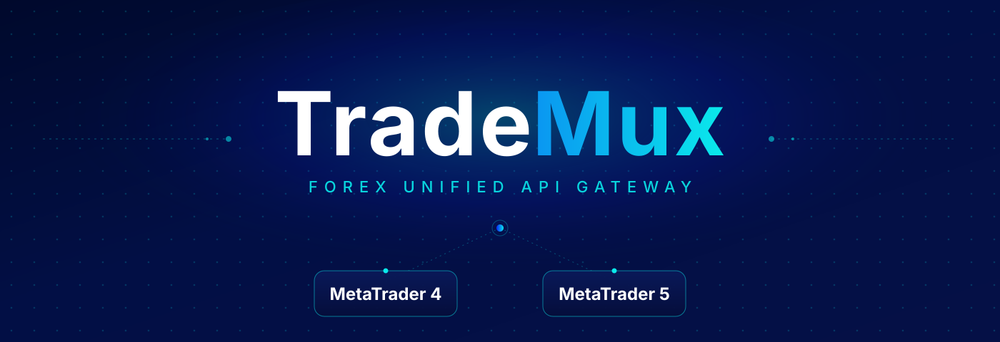

  

<h1 align="center">TradeMux Examples</h1>

Two beginner-friendly Python files for an MT4 or MT5 account connected to TradeMux:

| File | What it shows |
| --- | --- |
| [`trademux_basics.py`](trademux_basics.py) | Account details, quotes, candles, orders, positions, trade history, and account controls. |
| [`simple_strategy.py`](simple_strategy.py) | A loop that checks a breakout signal when each new bar appears and can send a market order. |

## Get started

1. Install the packages: `pip install -r requirements.txt`
2. Get a key from [TradeMux Console](https://console.trademux.io) and connect your MT4/MT5 account and TradeMux EA. See the [MetaTrader setup guide](https://docs.trademux.io/mt/setup).
3. Put your key in `TRADEMUX_API_KEY` at the top of the file you want to run. Set `SYMBOL` to the exact name in your terminal's Market Watch. No `.env` file is needed.
4. Run `python trademux_basics.py` or `python simple_strategy.py`.

`trademux_basics.py` has numbered sections with commented code. Edit values directly in the example calls, uncomment the lines you want to try, and run the file. It prints nothing until you enable a section. Order, modification, close, and kill-switch calls act on the connected account when uncommented. Try those on a demo account first. Keep your real API key out of commits.

`simple_strategy.py` checks for a new `TIMEFRAME` bar every `POLL_SECONDS`. At each new bar it compares the most recently closed candle with the candle before it: a close above the previous high is a buy signal, and a close below the previous low is a sell signal. It skips a signal if an open position already exists on `SYMBOL`. `PLACE_TRADES = True` sends market orders; set it to `False` to watch signals only. Stop the loop with Ctrl+C. It needs to stay running to catch each new bar.

These are learning examples, not a tested profitable strategy. See the [TradeMux MetaTrader SDK reference](https://docs.trademux.io/mt/) for all available methods and their parameters.

---

## About SkyBlue Fintech

TradeMux is built and operated by **SkyBlue Fintech Solutions LLP** ([corporate site](https://skybluefin.tech)), a Singapore-based Data Analytics and Processing Company and a member of the Singapore FinTech Association.

  

